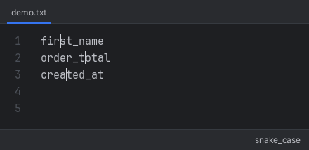

# Change Case Plugin
Change Case plugin for IntelliJ IDEs (e.g. PhpStorm, IntelliJ IDEA, ...)

Converts the selected text, or the word at the caret, to the next case format: camelCase, PascalCase, snake_case, SNAKE_CASE, kebab-case, space case and Title Case. Works with multiple carets.

Run it from Edit → Change Case or press Shift + Alt + U (⇧ + ⌥ + U on macOS). Which formats are used, and in which order, is set in Settings → Editor → Change Case.



## Install
Works with IntelliJ-based IDEs 2024.2 or newer.

This plugin is not published on the JetBrains Marketplace.

1. Build the zip (see [Build](#build)).
2. In the IDE open Settings → Plugins → ⚙ → Install Plugin from Disk…, pick the zip from the project's `build/distributions` folder (e.g. `~/projects/change-case-plugin/build/distributions/change-case-plugin-1.0.0.zip`) and restart the IDE.

## Build
Requirements: JDK 21 (e.g. [Eclipse Temurin](https://adoptium.net/)). Gradle itself is not needed, the wrapper downloads it.

Build the plugin:

```
./gradlew buildPlugin
```

The result is `build/distributions/change-case-plugin-<version>.zip`. On Windows use `gradlew.bat` instead of `./gradlew`.

Other useful tasks:

```
./gradlew test           # runs the unit tests
./gradlew verifyPlugin   # checks compatibility with PhpStorm (JetBrains Plugin Verifier)
./gradlew runIde         # starts a sandbox IDE with the plugin loaded, for manual testing
```
